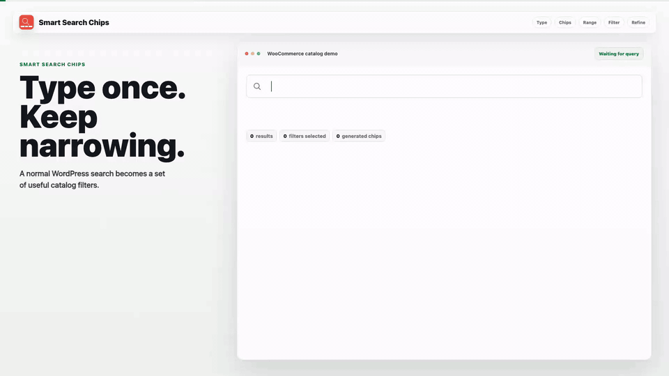
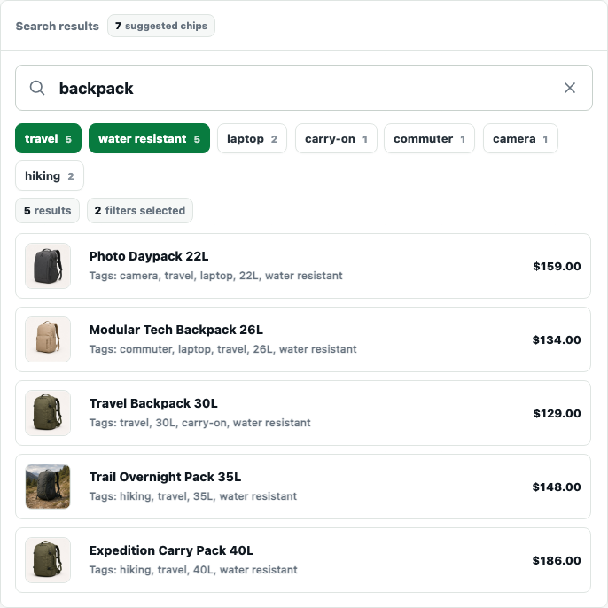
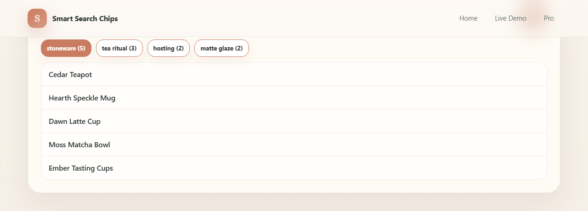

# Smart Search Chips

**Dynamic filter chips for WordPress and WooCommerce search.** Visitors search once, then narrow the results with one click, using chips generated from the results themselves, not from filters you had to design up front.



[WordPress.org](https://wordpress.org/plugins/smart-search-chips/) · [Changelog](CHANGELOG.md) · [Issues](https://github.com/JanBartos6/smart-search-chips/issues)

Smart Search Chips started as a commercial plugin with a paid Pro tier. Since **1.2.0** it is fully open source under the GPL, and every feature is included for everyone.

## What it does

A visitor types "backpack". The plugin finds the matching products, reads their tags, attributes and numeric values, and shows the chips that actually split that result set: *travel*, *water resistant*, *laptop*, *Volume 20–45 L*. Clicking a chip filters the list instantly; chips that would no longer narrow anything disappear.

- **Chips from your own data:** the built-in Search Chips Tags field, WooCommerce attributes, categories and tags, or existing ACF/custom fields.
- **Redundancy elimination:** a chip is only shown if it removes at least one result from the current set.
- **Numeric range chips:** values like `100 W`, `45 L` or `690 V => 63 A` become sliders with editable min/max fields.
- **Chip rules:** synonyms, pinned, hidden and renamed chips, with JSON import/export.
- **Local search index:** a batched, resumable index stored in your own database, with Relevanssi and `WP_Query` fallbacks.
- **Diagnostics:** an admin test search shows which search path ran and explains why chips did or didn't appear.
- **Search analytics (opt-in):** zero-result searches, chip and result clicks, funnels, CSV/chart exports and scheduled e-mail digests, all stored locally.
- **AI Prompt Builder:** prepares tagging prompts for the AI tool you already use. The plugin never calls an AI provider itself.
- **Works with any theme:** a Search block and `[sschp_search]` shortcode, optional enhancement of an existing theme AJAX search, and chips on product category archives.

<p>
  
  
</p>

## How the chips are chosen

1. The query runs through the local index, Relevanssi or `WP_Query`, and the top results are analysed (50 by default).
2. Every tag on those results is counted. Numeric facts (`Weight 420 g`) are grouped by dimension into range candidates.
3. Candidates are ranked by frequency. A chip is dropped if every result that has it is already covered by a selected chip's group, because clicking it would change nothing.
4. Chip rules (synonyms, pins, hides, renames) are applied, and active chips are moved to the front.

The core of this is in [`includes/class-chip-engine.php`](includes/class-chip-engine.php) and [`includes/class-range-filters.php`](includes/class-range-filters.php).

## Project layout

| Path | What's there |
| --- | --- |
| `smart-search-chips.php` | Bootstrap, activation, upgrade and uninstall |
| `includes/class-chip-engine.php` | Chip generation and redundancy elimination |
| `includes/class-search-handler.php` | AJAX search endpoint, caching, result shaping |
| `includes/class-search-index.php` | Local search index and its batch queue |
| `includes/class-relevance-scorer.php` | Fallback relevance scoring |
| `includes/class-search-explainer.php` | "Why no chips?" diagnostics |
| `includes/class-range-filters.php` | Numeric range chips |
| `includes/class-chip-rules.php` | Synonyms, pinned/hidden/renamed chips, import/export |
| `includes/class-analytics.php` | Local analytics, dashboard data, e-mail digests |
| `includes/class-ai-tagger.php` | AI Prompt Builder |
| `includes/class-frontend.php` | Block, shortcode, theme AJAX enhancement, archive chips |
| `includes/class-woocommerce.php` | Helper tags from product attributes and taxonomies |
| `includes/class-settings.php` | Admin screens |
| `tests/` | ~140 plain-PHP unit tests and Playwright browser tests |

## Development

Requirements: PHP 7.4+, Node 20, Docker (for the local WordPress site).

```bash
npm ci
npm run local:wp:start      # disposable WordPress on http://localhost:8899 with seeded demo content
php tests/unit.php          # unit tests
npm run test:browser        # Playwright tests against the local site
bash build.sh               # build the WordPress.org package (or: npm run build:wporg on Windows)
php scripts/validate-wporg-package.php
```

CI runs the unit tests, builds and validates the package, and runs the browser suite against a real WordPress install on every push. Releases are cut by pushing a `v*` tag; see [RELEASE.md](RELEASE.md).

## Contributing

Bug reports and pull requests are welcome. Please open an issue first for larger changes, and run `php tests/unit.php` before submitting.

## License

GPL-2.0-or-later. See [LICENSE](LICENSE).

Built by [Jan Bartoš](https://github.com/JanBartos6).
